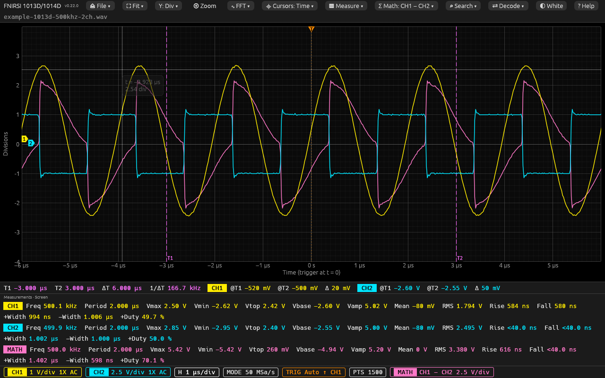
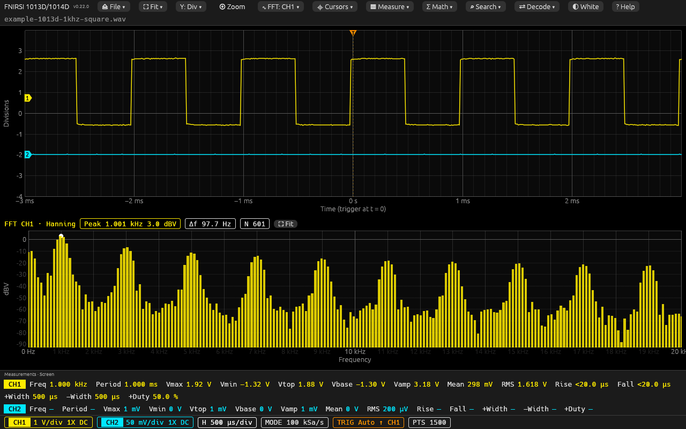
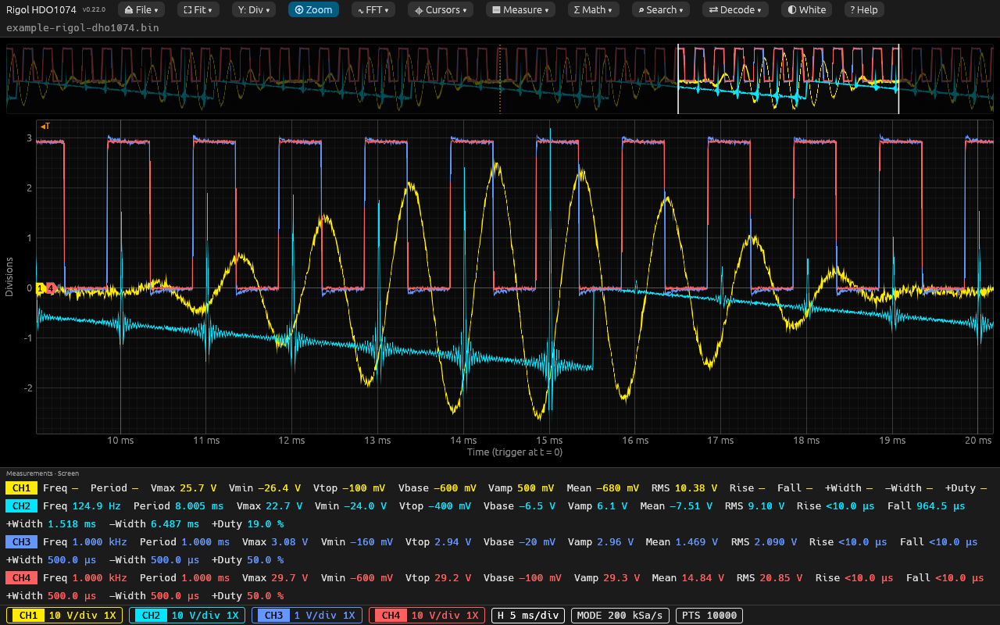
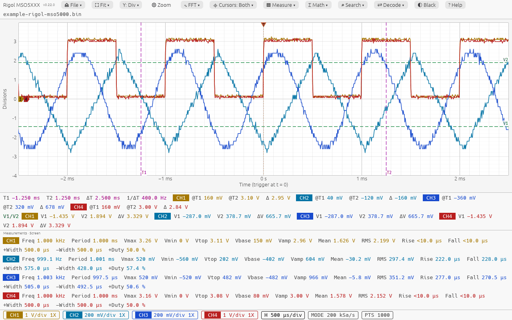
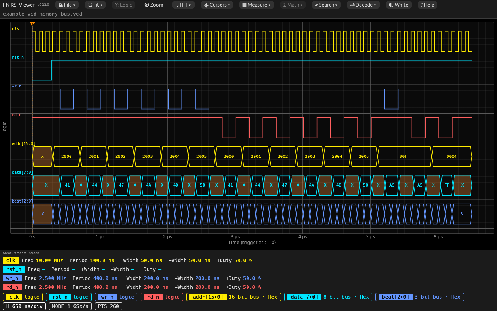
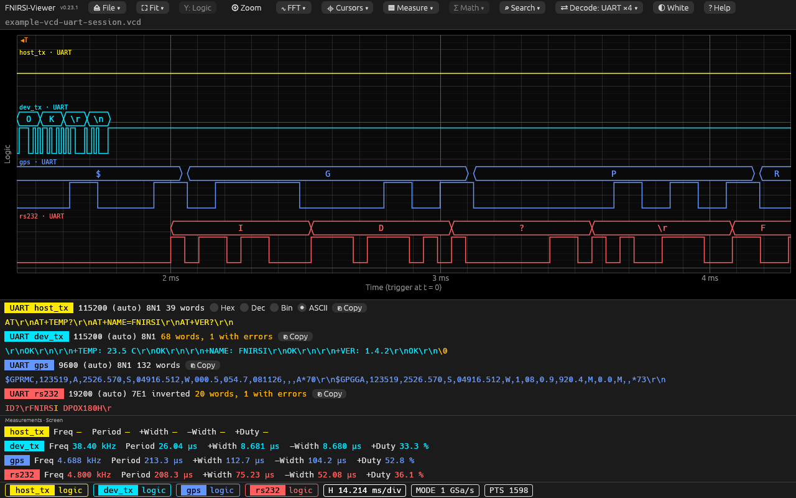
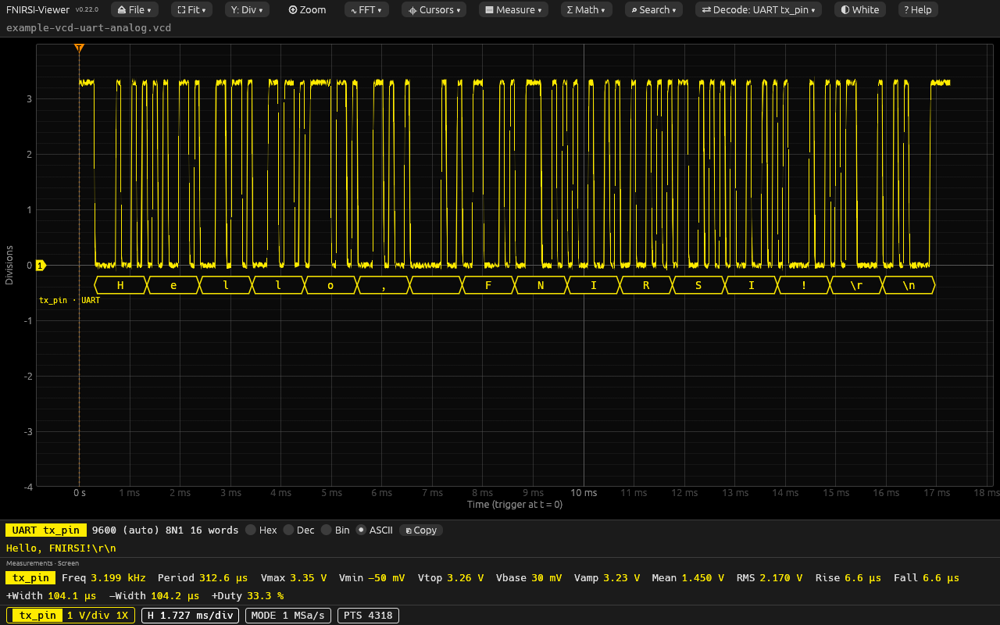
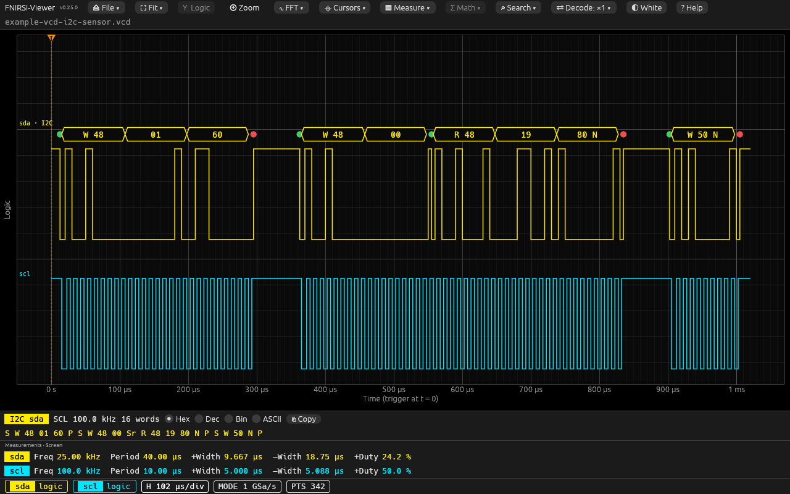
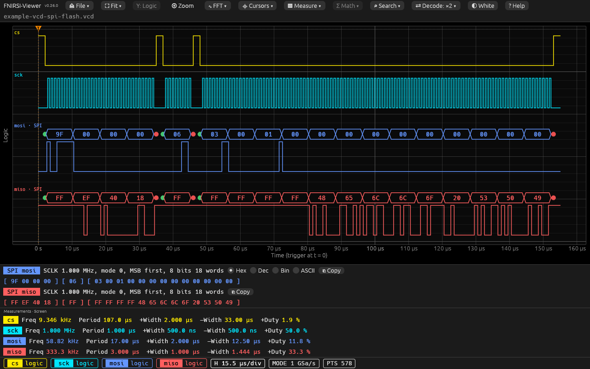

# fnirsi-viewer

A viewer for oscilloscope and logic analyzer files: FNIRSI `.wav` files,
Keysight/Agilent and Rigol files, VCD files and CSV tables. It runs on the
desktop and in a web browser (WebAssembly), with no installation:
**<https://afmiguel.github.io/fnirsi-viewer/>**.



*FNIRSI 1013D file (example "500 kHz on two channels"): two channels in Div
mode, time cursors T1 and T2, automatic measurements and the Math channel.*

## Features

- **Many file formats**, found automatically: FNIRSI DPOX180H and 1013D/1014D
  `.wav`, Keysight/Agilent and Rigol `.bin`, Rigol `.wfm`, VCD and CSV (see
  [Supported files](#supported-files)).
- **A scope screen**: 8 divisions with each channel at its own V/div and
  ground position (**Div**), or one axis in volts (**Volts**). Channel, time
  base, mode, trigger and record length readouts at the bottom (OSD).
- **Zoom and pan** with the mouse wheel, trackpad, keyboard or the overview
  strip (**⊕ Zoom**), and **⛶ Fit** to the whole record, to the samples or to
  the screen that the scope showed.
- **Automatic measurements** (15 values per channel) of the screen, of the
  whole record or between the cursors, with **statistics per cycle**.
- **Cursors**: time (T1, T2, ΔT, 1/ΔT and the voltage of each channel) and
  voltage (V1, V2, ΔV).
- **Math channel**: CH1 + CH2 or CH1 − CH2, measured like a channel.
- **Spectrum (FFT)** under the plot: 5 windows, dBV or V RMS, line or bars,
  peak readout.
- **Search** for rising edges, falling edges or glitches in the whole record.
- **Logic signals and buses** (VCD): one lane per signal, bus values in Hex,
  Dec, Bin or ASCII.
- **Protocol decoders** (logic analyzer): **UART**, **I2C** and **SPI**, on VCD
  lines or on analog channels; several lines at the same time, each with its
  own settings.
- **Reference waveform**: a second file drawn faint behind the traces.
- **Export** to CSV, **screenshot** (PNG) and **print**, with a white screen
  for paper.
- **Built-in examples**: real DPOX180H, 1013D and Rigol captures, and VCD files with
  buses and UART lines.
- The settings (Y mode, measurements, FFT, cursors, decoder…) are kept for the
  next session.

### Spectrum (FFT)



*FNIRSI 1013D file (example "1 kHz square wave"): FFT of CH1 as bars, Hanning
window. The odd harmonics of the square wave are at 3, 5, 7… kHz.*

**∿ FFT ▾** shows the spectrum of one channel under the time plot, of the
samples shown in the time plot (zoom in to analyse a part).

- Windows: Rectangular, Hanning, Hamming, Blackman-Harris and Flat top.
- Scale: dBV (0 dBV = 1 V RMS) or V RMS.
- Draw: a line, or bars (one bar per frequency bin, like a spectrum analyzer).
  Zoomed out, the bins in one screen column make one bar, at the highest level.
- Readouts: the peak (frequency interpolated between bins), Δf (the frequency
  step) and N (the samples used).
- The wheel zooms and a drag pans the spectrum; **⛶ Fit** next to the readouts
  (or a double-click) returns to the start view: up to 20 × the peak
  frequency.

### Zoom view and four channels



*Rigol DHO1074 `.bin` file (example): four channels, with the overview of the
whole record above the plot (**⊕ Zoom**). The bright window is the part shown.*

- Mouse wheel: zoom. Shift + wheel: time axis only. Alt + wheel: voltage axis
  only. Wheel over an axis: pan along that axis.
- Trackpad: a vertical swipe zooms, a horizontal swipe pans the time axis.
- Drag: pan. Double-click: reset the view.
- **⊕ Zoom**: click or drag in the overview to move there, wheel on it to zoom.
- **⛶ Fit ▾**: **Fit H** (full time span), **Fit V** (voltage axis fitted to the
  samples shown), **Fit both**, and **Scope screen** (the time window that the
  scope showed; a file opens on it when it stores it).

### Cursors, measurements and the white screen



*Rigol MSO5000 `.bin` file (example), on the white screen: time and voltage
cursors, and the measurements of four channels.*

- **⌖ Cursors ▾** (Off / Time / Volt / Both, and *Bring to view*): drag a
  dashed cursor line to move it, or use Tab and the arrow keys. A cursor
  outside the view shows an arrow at the edge (◀T1, V2▲). Time cursors show
  T1, T2, ΔT, 1/ΔT and each channel's voltage at T1 and T2 (linear
  interpolation). Voltage cursors show V1, V2 and ΔV.
- **▤ Measure ▾**: Freq, Period, Vpp, Vmax, Vmin, Vtop, Vbase, Vamp, Mean, RMS,
  Rise, Fall, +Width, −Width and +Duty, for the channels you choose. The
  samples measured: **Screen** (the time span shown), **Record** (the whole
  file) or **T1–T2** (between the time cursors).
  - Vtop and Vbase are the most common high and low levels (histogram).
  - Edges use the 10 %, 50 % and 90 % levels between Vbase and Vtop, with
    hysteresis. Glitches (two edges closer than 10 % of the typical edge
    spacing) are ignored.
  - With an amplitude below 0.1 division, the signal is taken as noise and
    the time measurements show "—".
  - **Statistics per cycle**: mean, min, max, σ and n of the time
    measurements, in a floating window.
- Readouts use 4 significant digits, and never more resolution than the
  samples have (one ADC code for voltages; Rise/Fall shorter than 2 samples
  show "<…"). If the signal is clipped, its voltage measurements are orange
  and start with "?": the real value can be larger.
- **◐ White / ◐ Black**: a white screen with darker colours, for printing.

### Logic signals and buses (VCD)



*VCD example "CPU bus": the clock, the strobes, and the buses `addr[15:0]`
and `data[7:0]` in hex. X marks a bus value with unknown bits (x or z).*

- 1-bit signals are drawn as steps, each in its own lane, under the analog
  traces; `real` variables are analog traces.
- A bus (up to 64 bits) is a lane with the value of each part written in it.
  Right-click (or long-press) the bus readout at the bottom to choose Hex, Dec,
  Bin or ASCII. Hover a lane to read the value at the pointer.
- With logic signals only, the y axis is "Logic"; Y, Math, voltage cursors and
  voltage measurements are off. The FFT shows frequencies, with levels in dB
  relative to the peak.

### Protocol decoders: UART



*VCD example "UART: complete session (4 lines)", all four lines decoded at the
same time, each with its own settings: `host_tx` and `dev_tx` at 115200 8N1,
`gps` at 9600 8N1, `rs232` at 19200 7E1 inverted. The bytes are just above
each signal, like a logic analyzer, and each line's text is under the plot.
Words with errors (the break on `dev_tx`, a parity error on `rs232`) are in
the warning colour.*



*VCD example "UART on an analog line": a 3.3 V line with slow edges and noise,
as an oscilloscope sees it. The baud rate (9600) and the threshold (1.65 V)
are found automatically. In Div mode the words go under the signal when there
is no room above it in the 8 divisions.*

**⇄ Decode ▾** makes serial lines into bytes. Check each line to decode
(several at the same time); the **▸** next to a line opens its own settings:

- **UART**: baud rate measured from the signal (rounded to a standard rate) or
  chosen; 5 to 9 data bits; parity None, Even or Odd; 1 or 2 stop bits; idle
  high, or low (an inverted line, such as RS-232 before the transceiver).
- A line is a channel of the oscilloscope or a VCD signal. The settings are
  kept by the name of the line, so they come back with the next file that has
  a line with that name. An analog channel is made into 0 and 1 with a
  threshold (in its ▸ settings): automatic (the middle of the
  signal, with hysteresis) or a value in volts.
- The words are drawn just above the decoded signal (a small band, 22 points
  high, that keeps its size when you zoom), and listed in a row under the plot
  in Hex, Dec, Bin or ASCII, one block per line. A click on a word centres it
  in the plot; **⎘ Copy** copies all the words of that line. Words with a parity or framing error are in
  the warning colour. The row warns when there are fewer than 4 samples per
  bit.
- The decoders are a module of their own (`src/decode/`, one file per
  protocol), so that more protocols can be added.

### Protocol decoder: I2C



*VCD example "I2C: temperature sensor": write a register of the sensor at 0x48,
read the temperature with a repeated start (0x19 0x80, the last byte with a
NACK), and an address that nobody answers (0x50, NACK). Green dot: start or
repeated start; red dot: stop.*

- Check the **SDA** line in **⇄ Decode ▾**; in its **▸** settings choose
  **I2C** and the **SCL** line. A line named `sda` gets I2C with the line
  named `scl` by itself.
- The decoder shows the start (**S**) and repeated start (**Sr**), the 7-bit
  address with the direction (**W 48**, **R 48**), the data bytes, the stop
  (**P**), and **N** after a byte that was not acknowledged (NACK). A byte cut
  by a start or stop is marked as incomplete, in the warning colour.
- The clock rate (SCL) is measured and shown in the row.
- It works on two channels of an oscilloscope too (the DPOX180H has two):
  example "I2C on two analog channels", CH1 = SDA, CH2 = SCL.

### Protocol decoder: SPI



*VCD example "SPI: flash memory" (1 MHz, mode 0): MOSI sends the commands
(0x9F JEDEC ID, 0x06 write enable, 0x03 read at 0x000100) and MISO answers
(EF 40 18, then "Hello SPI" = 48 65 6C 6C 6F 20 53 50 49). Green and red dots:
CS active and released.*

- Check the data line (**MOSI** or **MISO**; check both to see both
  directions). In its **▸** settings choose **SPI**, the **SCLK** line, the
  **CS** line (or None), the **mode** (0–3: clock polarity and phase), the bit
  order (MSB or LSB first) and the word size (4–16 bits). Lines named
  `mosi`/`miso` get SPI with the lines named `sck`/`sclk` and `cs` by
  themselves.
- With CS, the words are counted from the start of each selection, shown as
  `[` … `]` in the row; a word cut by CS is marked as incomplete.
- Without CS (a two-channel oscilloscope: data and clock), a pause of the
  clock longer than 3 clock periods starts a new word. Example "SPI on two
  analog channels (no CS)".

### Other functions

- **Σ Math ▾**: CH1 + CH2 or CH1 − CH2 (sample by sample, in volts), drawn
  and measured like a channel (MATH row).
- **⌕ Search ▾**: rising edges, falling edges or glitches in the whole record
  of a channel. Marks on the bottom edge show them; [ and ] centre the view on
  the previous and next one.
- **File ▾ → Open reference…**: a second file drawn faint behind the traces,
  to compare. The REF readout at the bottom hides or shows it.
- **File ▾ → Export CSV…**, **Save screenshot (PNG)…** and **Print…** (on a
  white screen).
- Click the **CH1**, **CH2**… readout at the bottom to hide or show that
  channel (its trace, ground marker, measurements and cursor values). Mouse
  wheel on it: V/div of that channel (1-2-5 steps, Div mode; * = not the
  file's V/div).
- Drag a ground marker (**1▶**, **2▶**) to move that channel (this switches Y
  to Div, where each channel has its own scale).
- The time axis has the trigger at t = 0 (the "T" marker on the top edge). The
  voltage axis is in volts at the probe tip (the V/div that the scope shows
  already includes the probe setting).
- If a file cannot be opened, a banner says why, and the file shown before
  stays. If the format is not certain, a window asks which one it is.

## Supported files

The format is found automatically from the file; if it is not certain, a
window asks.

| Model | File | Notes |
|-------|------|-------|
| FNIRSI DPOX180H | `.wav`, variable size, big-endian | Full ADC buffer; real-time and equivalent-time modes; coupling and trigger settings |
| FNIRSI 1013D, 1014D | `.wav`, 15000 bytes, little-endian | Original FNIRSI firmware only. 1500-sample buffer (30 divisions), coupling and trigger settings. The 1014D uses the 1013D format, but no 1014D file was tested |
| Keysight / Agilent | `.bin` (AG01, AG03, AG10) | Up to 4 channels; volts or amperes; no V/div in the file (a V/div that fits is used) |
| Rigol | `.bin` (MSO5000 RG01, DHO800/1000 RG03) | Same layout as Keysight `.bin` |
| Rigol | `.wfm` (DS1000Z, DS1000E/D, DS2000) | V/div, probe, coupling and time/div from the file; 8-bit samples. Logic analyzer data is not read |
| VCD | `.vcd` (logic analyzers, MSO, simulators) | 1-bit signals as digital lanes, buses (up to 64 bits) as value lanes, `real` variables as analog traces |
| CSV / text, any oscilloscope | `.csv`, `.txt`: time + channel columns | Keysight, Rigol, Tektronix, Siglent layouts and this viewer's export; `,` `;` tab separators |

The FNIRSI `.wav` files are **not** audio files. Each model has its own binary
format, and FNIRSI does not publish them. Other FNIRSI models (2C53T, 2C53P,
2C23T and others) save other formats and are not supported.

## Use

- Drop a file on the window, or use **⏏ File ▾ → Open file…** (Ctrl/⌘+O).
- **File ▾ → Open example**: real FNIRSI DPOX180H and 1013D captures, Rigol captures, and VCD
  files made for the viewer (a CPU bus, a DAC, and UART, I2C and SPI examples).
- The welcome screen lists all the controls; **? Help** (F1) has the main
  instructions.
- Keyboard: Ctrl/⌘+O open, Ctrl/⌘+P print, F1 help, F/H/V fit, Z zoom view,
  S FFT, Y volts/div, C cursors, Tab + arrows move a cursor, 1/2 hide a
  channel, +/− zoom, arrows pan, [ and ] previous/next search result.

## Build and run

Desktop:

```bash
cargo run --release
```

Web (needs `rustup target add wasm32-unknown-unknown` and `cargo install trunk`):

```bash
trunk serve --release
```

Static build for GitHub Pages (the site is served from `/<repository>/`):

```bash
trunk build --release --public-url /fnirsi-viewer/
```

Then publish the `dist/` folder. The workflow `.github/workflows/pages.yml` does
this on each push to `main`.

## Code structure

| Path | Contents |
|------|----------|
| `src/model.rs` | Internal model: `Capture`, `Trace`, `Samples`, display settings |
| `src/formats/` | One module per file format, detection (`probe`) and `open` |
| `src/app/` | User interface: `mod.rs` (state), `menus`, `readouts`, `plot`, `input`, `dialogs`, `actions`, `format` |
| `src/measure.rs`, `src/fft.rs`, `src/cursors.rs` | Measurements, spectrum, cursors (work on any trace) |
| `src/decode/` | Protocol decoders: shared logic-level code (`mod.rs`) and one file per protocol (`uart.rs`, `i2c.rs`, `spi.rs`) |
| `src/export.rs`, `src/examples.rs`, `src/palette.rs` | CSV/PNG/print, built-in examples, colours |

To add a file format: write a module in `src/formats/` that implements
`Format` (`name`, `probe`, `read` → `Capture`), add it to `FORMATS`, and add
tests with real files.

## Versions

See [CHANGELOG.md](CHANGELOG.md). The version is in `Cargo.toml`. The app shows
it next to the title (hover it for the git commit), so each build can be
identified, also between releases. To release: raise the version in
`Cargo.toml`, add a CHANGELOG entry, commit, and tag `vX.Y.Z`.

## Tests

Unit tests use synthetic files. The integration tests in `tests/real_samples.rs`
use real files: DPOX180H files from
[Rav263/fnirsi-wave-decoder](https://github.com/Rav263/fnirsi-wave-decoder)
(no license) and 1013D files from lexus2026HA/FNIRSI-2C53T-Decoder
(CC BY-NC 4.0), and Keysight/Agilent and Rigol files from
[scottprahl/RigolWFM](https://github.com/scottprahl/RigolWFM) (BSD-3-Clause).
The files are not stored here. Download them
first:

```bash
./scripts/fetch-samples.sh
cargo test
```

## File format: DPOX180H

All values are big-endian. Offsets are from the start of the file.

| Offset | Type | Field |
|--------|------|-------|
| 0x00 | 7 × u32 | Section table: settings start/size, screen start/size, waveform start/size, total size |
| 0x66 / 0xA6 | u8 | CH1 / CH2 enabled |
| 0x67 / 0xA7 | u8 | CH1 / CH2 coupling: 0 = DC, 1 = AC |
| 0x6E / 0xAE | u64 | CH1 / CH2 V/div in µV (as shown, includes the probe factor) |
| 0x7E / 0xBE | u16 | CH1 / CH2 ground marker, screen pixels (100 = centre, 25 px/div) |
| 0x82 / 0xC2 | u64 | CH1 / CH2 probe factor × 10000 (10000 = 1X, 100000 = 10X) |
| 0xFA | u8 | Trigger mode: 0 = Auto, 1 = Single, 2 = Normal |
| 0xFB | u8 | Trigger edge: 0 = rising, 1 = falling |
| 0xFC | u8 | Trigger source: 0 = CH1, 1 = CH2 |
| 0x12D | u32 | Samples per channel |
| 0x13D | u32 | Sample rate in Hz (overflows above 4.29 GS/s) |
| 0x1D9 | u32 | Time/div in ps |
| waveform start | u16[] | CH1 samples (if on), then CH2 samples (if on) |

Conversion:

- ADC codes: 0 to 12800, 1600 codes per division, centre 6400.
- Ground code = 6400 + (marker − 100) × 64.
- Voltage = (code − ground) / 1600 × V/div.
- Real-time mode: Δt = 1 / sample rate, trigger at the centre of the buffer.
- Equivalent-time (ETS) mode, at fast timebases: the buffer holds frames of
  300 points (one per screen pixel, 12 divisions). The viewer shows the first
  frame; Δt = 12 × time/div / 300, trigger at point 150.

The section table, enable flags, sample count and time/div come from the
firmware analysis in Rav263/fnirsi-wave-decoder. The V/div in µV, the probe
factor, the ground marker, the ETS frame layout and the trigger position were
found by comparing real files with the screen of the scope. The coupling and
trigger bytes, and the CH1-then-CH2 data layout, were found with a sequence
of files saved on a real DPOX180H, with one setting changed in each file.

### Not verified yet

- Trigger mode Single (value 1): it was not in the sequence. It is the value
  between Auto and Normal, as in the 1013D.
- The trigger level: it was not found in the file.
- The sample rate in real-time mode is verified only at 400 MS/s.
- A ground marker far from the centre, and slow (roll) timebases.

### Copying files from the DPOX180H

The USB disk of the DPOX180H can disconnect during a copy with `cp` or the
Finder ("Device not configured"); the scope must then be switched off and on.
`scripts/copy-dpox.py` reads in small pieces and waits for the disk to come
back:

```bash
python3 scripts/copy-dpox.py ~/Downloads/dpox
```

Connect the scope directly to the computer (not through a dock or hub) and do
not open the disk in the Finder during the copy.

## File format: 1013D / 1014D

15000 bytes, little-endian. Bytes 0–999 are the header; CH2 settings are at the
CH1 offset + 10.

| Byte | Field |
|------|-------|
| 2 / 12 | CH1 / CH2 shown (0 = off) |
| 4 / 14 | V/div index: 5, 2.5, 1, 0.5, 0.2, 0.1, 0.05 V (times the probe) |
| 8 / 18 | Coupling: 0 = DC, 1 = AC |
| 10 / 20 | Probe: 10^n (1X, 10X, 100X) |
| 22 | Time/div index 0..29: 50 s … 10 ns (1-2-5 steps) |
| 26 / 28 / 30 | Trigger mode (Auto, Single, Normal) / edge (0 = rising) / source (0 = CH1) |
| 84 / 86 | u16: buffer value of 0 V for CH1 / CH2 |
| 1000 / 4000 | CH1 / CH2 buffer: 1500 × u16 |

- Voltage = (value − zero) / 50 × V/div. Δt = time/div / 50.
- The trigger is at the centre of the buffer (sample 750).
- Sources: Robert Tidey
  ([FNISR1013DScope](https://github.com/roberttidey/FNISR1013DScope)), W. Voigt
  (zero level) and
  [lexus2026HA/FNIRSI-2C53T-Decoder](https://github.com/lexus2026HA/FNIRSI-2C53T-Decoder)
  (header bytes checked against screenshots). The tests use 21 real files from
  that last repository (CC BY-NC 4.0, downloaded by `scripts/fetch-samples.sh`,
  not stored here).
- Other firmware (Peco, Atlan) writes another layout. Such files are rejected
  with an error message.

## Example files

The files in `assets/examples/1013d/` are FNIRSI 1013D captures by
lexus2026HA, from
[lexus2026HA/FNIRSI-2C53T-Decoder](https://github.com/lexus2026HA/FNIRSI-2C53T-Decoder),
licensed [CC BY-NC 4.0](https://creativecommons.org/licenses/by-nc/4.0/). They
are not changed.

The files in `assets/examples/rigol/` are Rigol captures (DHO1074 and MSO5000
`.bin`, DS2072A and DS1102E CSV) from
[scottprahl/RigolWFM](https://github.com/scottprahl/RigolWFM), copyright (c)
2020-23 Scott Prahl, licensed BSD 3-Clause (full text in
`assets/examples/rigol/LICENSE.txt`). They are not changed.

The files in `assets/examples/vcd/` are not captures: `scripts/make-vcd-examples.py`
makes them (a CPU bus with write and read cycles, an 8-bit DAC with its analog
output, and UART, I2C and SPI examples). Run the script again to make the same files.

The images in `docs/images/` are screenshots of this viewer with the example
files above.

The files in `assets/examples/dpox180h/` are DPOX180H captures saved for this
project by its author (a 1 kHz square wave on CH1, and on CH1 and CH2 with CH2
in AC coupling). They are part of this project, under the same terms as its
source code.
